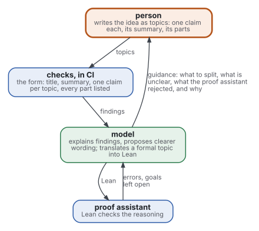
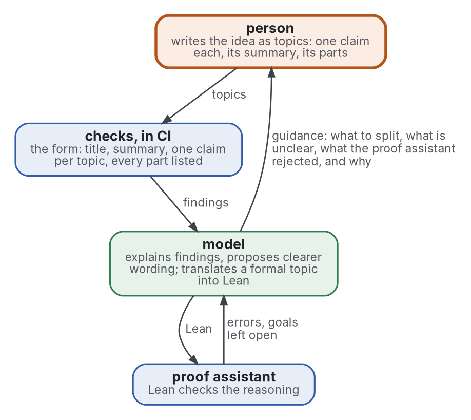

# Blueprint

[](https://github.com/Tewf/reader-ergonomics-blueprint/actions/workflows/checks.yml)
[](https://tewf.github.io/reader-ergonomics-blueprint/)

Le raisonnement d'une personne écrit comme un arbre de topics, chaque partie avec un vérificateur, Lean d'abord pour la
logique. Un modèle de langue interprète les verdicts et oriente, pour que la personne ne se perde pas et que le
raisonnement se transmette. Les mathématiques formelles appellent un tel graphe d'affirmations vérifiées un
**blueprint**.

Cette page en anglais : [README.md](README.md). Les deux versions suivent le même état.

> **État (2026-10-29) :** la revue de l'autoformalisation est faite, grise et formelle, 273 sources, et nomme sa
> référence, B1. Rien de la boucle n'est encore construit ; la première construction est une petite preuve écrite en
> topics. Le travail a commencé dans reader-ergonomics-topic et a migré ici avec son historique
> ([0001](decisions/0001-a-repository-of-its-own.md)).
>
> **Comment il est fait :** avec Claude, un assistant IA d'Anthropic, sous la direction du mainteneur, comme
> reader-ergonomics. Les corrections sont bienvenues sous forme d'issues.

## Où il se place

- **Il s'appuie sur le [topic](https://github.com/Tewf/reader-ergonomics-topic/blob/092ae2fc2e07226b695e219e3eb14b40286faa25/shapes/topic.md)** (reader-ergonomics-topic v0.6.0) : chaque nœud d'un blueprint est
  un topic, avec son titre, son résumé, ses parties comme contenu et ce qu'il utilise comme liens.
- **Il obéit à [reader-ergonomics](https://github.com/Tewf/reader-ergonomics/blob/7a76cc6a86b7a5c1e451e4416534d113abd0f594/standard.md)** (v1.13.0) et exécute ses vérifications en CI.
- **Il ne pointe que vers le bas.** Les deux sont épinglés par commit ; aucun ne pointe vers ce dépôt.

## La boucle



<details>
<summary>Source Graphviz</summary>



</details>

La figure se lit de la personne vers le bas ; ce qui revient, erreurs et buts vers le modèle, orientation vers la
personne, remonte. Chaque partie a un rôle :

| Partie | Rôle | Décide |
|---|---|---|
| **personne** | possède le raisonnement ; écrit chaque étape comme un topic | ce qui est affirmé |
| **vérifications** | des programmes : la [vérification du topic](https://github.com/Tewf/reader-ergonomics-topic/blob/092ae2fc2e07226b695e219e3eb14b40286faa25/checks/local/topic.py) et celles de reader-ergonomics | si la forme est claire |
| **modèle** | un modèle de langue : explique, propose, traduit | rien : sa sortie est toujours vérifiée |
| **assistant de preuve** | Lean, pour ce qui est formalisé | si le raisonnement est valide |

## Périmètre

| | Quoi | Pourquoi |
|---|---|---|
| dedans | tout raisonnement ou toute création, écrit comme un arbre ou un graphe de topics | un topic peut porter toute information |
| dedans | les propriétés du topic sur chaque nœud : titre et résumé, parties comme contenu, usages comme liens, pas de cycle, trois niveaux en vue | la personne ne se perd pas, et le raisonnement se transmet |
| dedans | un vérificateur pour chaque partie | chaque affirmation est vérifiée là où elle se trouve, pas le tout à la fin |
| dedans | Lean comme oracle pour la logique et les preuves, premier et pour l'instant seul vérificateur du sens | son verdict est exact |
| dedans | le modèle comme interprète des verdicts et comme guide ; il ne décide rien et ne découpe jamais à la place de la personne | conditions 2 et 4 de la [position](evidence/autoformalization/position.md) de la revue |
| plus tard | d'autres vérificateurs (sources, tests, spécifications), après une revue des assurance cases | une affirmation découpée en sous-affirmations, chacune appuyée par une preuve, est ce que l'ingénierie des systèmes appelle un assurance case |
| dehors | construire un prouveur ou entraîner un modèle | d'autres le font ; ce dépôt s'en sert |
| dehors | le gabarit du topic lui-même | reader-ergonomics-topic le porte ; ce dépôt en épingle une version |

## Ce que la revue a trouvé

La [revue](evidence/autoformalization/) lit 80 sources grises et 182 formelles, et 11 liées depuis des revues voisines.

- Aucun programme ne décide si un énoncé formel dit ce que dit sa source ; la recherche le mesure contre des personnes
  ou contre un énoncé de référence vérifié.
- Les juges-modèles surestiment les traductions : un traducteur obtient 97,5 % selon son juge et 62,7 % selon des
  personnes. Les énoncés écrits à la main des benchmarks sont eux-mêmes faux dans 16,4 % et 38,5 % de deux benchmarks.
- Pour un modèle, le message d'erreur du vérificateur est ce qui fait marcher la réparation ; pour des personnes, aucune
  étude des messages d'un assistant de preuve n'a été trouvée.
- Découper le raisonnement en petites affirmations aide toujours la vérification, et la pensée seulement là où la
  personne a fait le découpage ; aucun essai randomisé n'a été trouvé.

## La référence

**B1, le blueprint audité** ([baseline](evidence/autoformalization/baseline.md)) :

- un blueprint de petits lemmes, chaque énoncé copié de sa source ;
- un modèle peut écrire les preuves, et ne décide rien ;
- Lean vérifie chaque soumission en CI, et comparator vérifie que chaque preuve prouve l'énoncé posé ;
- une personne contrôle chaque énoncé contre sa source.

## Suite

1. **La première construction :** un court théorème écrit comme un arbre de topics, chaque affirmation liée à une
   déclaration Lean, avec Lean et la vérification du topic en CI : B1 en miniature.
2. **Ensuite la boucle :** la place du modèle, comme interprète et guide, mesurée contre B1.
3. **Avant tout vérificateur autre que Lean :** une revue des assurance cases, le nom que le domaine donne au cas
   général.

## Contenu

| Partie | Résumé |
|---|---|
| [evidence](evidence/) | la revue derrière le dépôt : l'autoformalisation, grise et formelle, et sa bibliographie |
| [decisions](decisions/) | un compte rendu par choix qui façonne ce dépôt, chacun ouvert par la décision en une phrase |

## Le vérifier

```sh
git clone https://github.com/Tewf/reader-ergonomics
python3 reader-ergonomics/checks/run.py chemin/vers/ce/dépôt
```

La CI exécute les mêmes vérifications à chaque push, aux commits qu'épingle [checks.yml](.github/workflows/checks.yml).

## Licence

Code sous [Apache License 2.0](LICENSE) ; prose sous [CC BY 4.0](LICENSES/CC-BY-4.0.txt). Réutilisez-le librement, en
citant ce dépôt ; [CITATION.cff](CITATION.cff) donne une citation si besoin.
