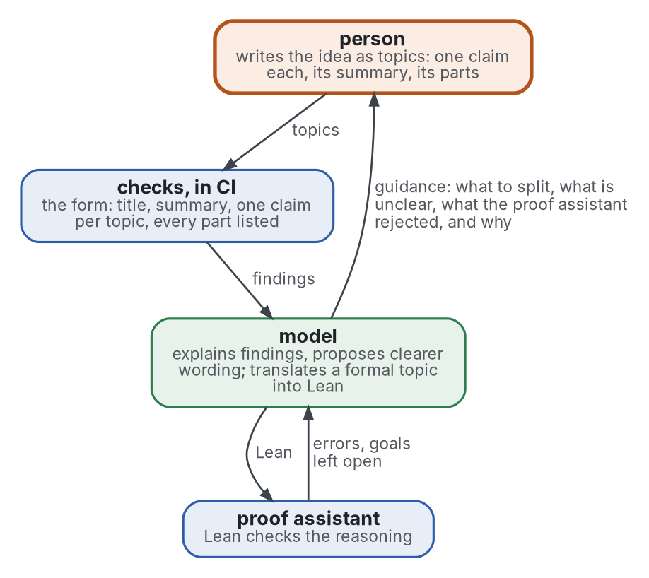

# Blueprint

[](https://github.com/Tewf/reader-ergonomics-blueprint/actions/workflows/checks.yml)
[](https://tewf.github.io/reader-ergonomics-blueprint/)

A person's reasoning written as a tree of topics, each part with a checker, Lean for logic first. A language model
interprets the verdicts and guides, so the person does not get lost and the reasoning can be communicated. Formal
mathematics calls such a graph of checked claims a **blueprint**.

This page in French: [README.fr.md](README.fr.md).

> **Status (2026-10-29):** the review of autoformalization is done, grey and formal, 273 sources, and names its
> baseline, B1. Nothing of the loop is built yet; the first build is one small proof written as topics. The work began
> in reader-ergonomics-topic and moved here with its history ([0001](decisions/0001-a-repository-of-its-own.md)).
>
> **How it is made:** with Claude, an AI assistant by Anthropic, under the maintainer's direction, the way
> reader-ergonomics was made. Corrections are welcome as issues.

## Where it sits

- **It builds on the [topic](https://github.com/Tewf/reader-ergonomics-topic/blob/092ae2fc2e07226b695e219e3eb14b40286faa25/shapes/topic.md)** (reader-ergonomics-topic v0.6.0): every node of a blueprint is a
  topic, with its title, its summary, its parts as contents and what it uses as links.
- **It obeys [reader-ergonomics](https://github.com/Tewf/reader-ergonomics/blob/7a76cc6a86b7a5c1e451e4416534d113abd0f594/standard.md)** (v1.13.0) and runs its checks in CI.
- **It links down only.** Both are pinned by commit; neither links up to this repository.

## The loop


<details>
<summary>Graphviz source</summary>



</details>

The figure reads from the person downward; what comes back, errors and goals to the model and guidance to the person,
runs upward. Each part has one role:

| Part | Role | Decides |
|---|---|---|
| **person** | owns the reasoning; writes each step as a topic | what is claimed |
| **checks** | programs: the [topic check](https://github.com/Tewf/reader-ergonomics-topic/blob/092ae2fc2e07226b695e219e3eb14b40286faa25/checks/local/topic.py) and the reader-ergonomics checks | whether the form is clear |
| **model** | a language model: explains, proposes, translates | nothing: its output is always checked |
| **proof assistant** | Lean, for what is formalized | whether the reasoning is valid |

## Scope

| | What | Why |
|---|---|---|
| in | any reasoning or creation, written as a tree or graph of topics | a topic can hold any information |
| in | the topic's properties on every node: title and summary, parts as contents, uses as links, no cycle, three levels in view | the person does not get lost, and the reasoning can be communicated |
| in | a checker for each part | each claim is checked where it stands, not the whole at the end |
| in | Lean as the oracle for logic and proofs, the first and for now only checker of meaning | its verdict is exact |
| in | the model as interpreter of the verdicts and as guide; it decides nothing and never splits for the person | conditions 2 and 4 of the review's [position](evidence/autoformalization/position.md) |
| later | other checkers (sources, tests, specifications), after a review of assurance cases | a claim split into sub-claims each backed by evidence is what systems engineering calls an assurance case |
| out | building a prover or training a model | others do it; this uses them |
| out | the topic template itself | reader-ergonomics-topic holds it; this repository pins a release |

## What the review found

The [review](evidence/autoformalization/) reads 80 grey and 182 formal sources, with 11 linked from sibling reviews.

- No program decides whether a formal statement means what its source means; research measures it against people or
  a vetted reference.
- Model judges overrate translations: one translator scored 97.5% by its judge and 62.7% by people. Benchmarks' own
  human-written statements are wrong in 16.4% and 38.5% of two benchmarks.
- For a model, the checker's error message is what makes repair work; for people, no study of a proof assistant's
  messages was found.
- Splitting reasoning into small claims helps checking every time, and thinking only where the person did the
  splitting; no randomised trial was found.

## The baseline

**B1, the audited blueprint** ([baseline](evidence/autoformalization/baseline.md)):

- a blueprint of small lemmas, each statement copied from its source;
- a model may write proofs, and decides nothing;
- Lean checks every submission in CI, and comparator checks that each proof proves the stated claim;
- a person audits each statement against its source.

## Next

1. **The first build:** one short theorem written as a tree of topics, each claim tied to a Lean declaration, with Lean
   and the topic check run in CI: B1 in miniature.
2. **Then the loop:** the model's place in it, as interpreter and guide, measured against B1.
3. **Before any checker other than Lean:** a review of assurance cases, the field's name for the general case.

## Contents

| Part | Summary |
|---|---|
| [evidence](evidence/) | the review behind the repository: autoformalization, grey and formal, and its bibliography |
| [decisions](decisions/) | one record per choice that shapes this repository, each opening with the decision in one sentence |

## Check it

```sh
git clone https://github.com/Tewf/reader-ergonomics
python3 reader-ergonomics/checks/run.py path/to/this/repository
```

CI runs the same checks on every push, at the commits [checks.yml](.github/workflows/checks.yml) pins.

## Licence

Code under the [Apache License 2.0](LICENSE); prose under [CC BY 4.0](LICENSES/CC-BY-4.0.txt). Reuse it as you wish, with
credit to this repository; [CITATION.cff](CITATION.cff) gives a citation if you need one.
