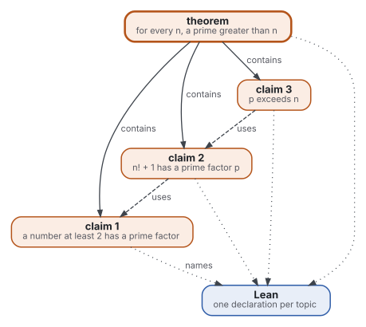
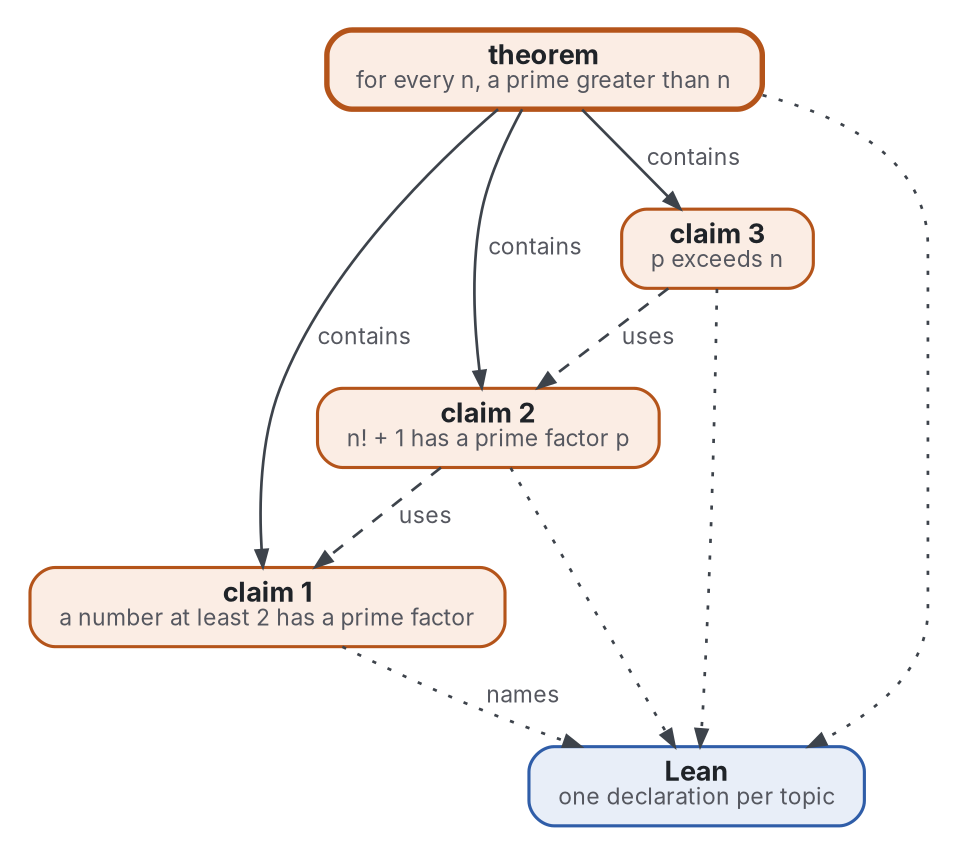

# The first build: Euclid's theorem as topics checked by Lean

**Decision asked.** Whether the first build is one classical theorem written as a tree of topics. Each claim is tied
to one Lean declaration, and three checks run in CI. The maintainer decides before the build is pushed.

**Status.** accepted, 2026-11-03. **Shape:** [design document](https://github.com/Tewf/reader-ergonomics-software-design/blob/48b497ba591e9d6ffc962b1d08448930fa8158de/shapes/design-document.md)

**Summary.** The smallest blueprint that exercises every part of the loop but the model: Euclid's theorem, three
claims, one topic each, one Lean declaration each. A program checks the form of the topics, a second program checks
that every topic names a declaration that exists, and Lean checks the proofs.

## Motivation

The review names the baseline, B1, and nothing of it is built. A first build shows that the pieces meet before
the model joins them.

- Use case: a person writes a short proof as topics. Today nothing says whether a topic's Lean declaration exists,
  or whether Lean accepts it.
- Use case: a reader of the proof wants to see each claim alone, and the one it depends on, without the others.

## Goals and non-goals

- Goal: every claim is its own topic, and the topic check passes on each.
- Goal: every topic under `proofs/` names exactly one Lean declaration, and that declaration is in the Lean sources.
- Goal: `lake build` in CI proves the declarations and fails on any `sorry`.
- Non-goal: a model in the loop. It comes next, measured against B1.
- Non-goal: comparator and a challenge file. They finish B1 and come after this build.
- Non-goal: a checker other than Lean. It waits for a review of assurance cases.

## Design

Graphviz source

- **Theorem and claims:** the theorem, in `proofs/infinitely-many-primes/`, holds three claims as its
  contents, one file each beside it. Each opens with a title and a summary, as every topic does.
- **Link to Lean:** each topic carries one line, `**Lean:** \`Blueprint.InfinitelyManyPrimes.<name>\``.
- **Lean project:** a Lake project at the root, on Mathlib, its toolchain taken from Mathlib's tag.
- **Three checks, three CI steps:** the topic check; `checks/local/lean_link.py`, which reads the Lean sources
  and the topics and compares the names; `lake build`, with Mathlib's cache.

The records [0003](../decisions/0003-euclids-theorem-as-the-first-proof.md) to
[0005](../decisions/0005-three-checks-each-its-own-ci-step.md) keep each choice.

## Alternatives

| Option | Consequences | Why it lost |
|---|---|---|
| A longer theorem (irrationality of the square root of 2, a lemma of a course) | more claims, nearer to use | the build would test the theorem, not the pipeline |
| Core Lean without Mathlib | no cache to fetch, a fast build | the claims would be proved from scratch, and the miniature becomes a library |
| One checker for link and build, in `lake` | one step | a missing name and a failing proof are different findings; a program can say which |
| Match topic to declaration by file name | no `**Lean:**` line | a rename of either breaks the link silently, and the line is what a reader sees |

## Consequences

- Drawbacks: Mathlib is large, so a cold CI run is slow without the cache, and the Lake manifest pins one Mathlib
  version that a later bump must move.
- Risks: the link check reads names, not meaning. Nothing here shows that a Lean statement says what its topic says.
  That is the audit of B1, done by a person, and comparator does not replace it.
- Compatibility: the topic check and the standard's checks run unchanged on the new folder.
- Security: CI runs `lake exe cache get` from Mathlib's public cache, and no secret.

## Feasibility and plan

- Shown to work by: each claim is a one-line Mathlib lemma or close to it, and the proof was built locally.
- Tested by: the topic check, unit tests for the link check, and `lake build` without `sorry`.
- Rolled out by: this design, the records, the proof as topics, the Lake project, the link check, the CI steps, in
  that order, one commit each.

## Open questions

- Whether the link check should also read the declaration's statement, to show it beside the topic. Not decided.
